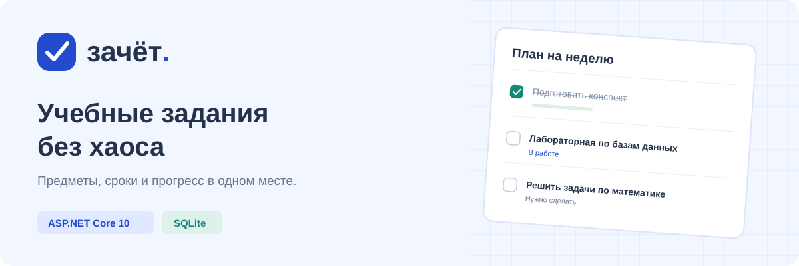

<p align="center">
  
</p>

<p align="center">
  <a href="https://github.com/Eksailed/study-tracker/actions/workflows/check.yml"></a>
  
  
</p>

# Зачёт: учебные задания и сроки сдачи

Статус: сделано, версия 0.2 от 6 ноября 2026 года. Готовы личные аккаунты, свои задания, миграции, перенос старой базы, восстановление черновика и запуск в Docker с HTTPS. Проверены пересоздание контейнера и восстановление резервной копии. В интернет приложение пока не размещено: сервер и домен не выбраны. Вложения и напоминания не реализованы.

Связано: [сервер](Program.cs), [модели и база](Models.cs), [интерфейс](wwwroot/index.html), [проверки API](tests/test_api.py).

«Зачёт» помогает держать учебные дела в одном месте: записывать задания, следить за сроками и видеть, сколько уже сделано. Приложение работает в браузере, хранит данные в SQLite и подстраивается под экран телефона. Отдельная сборка интерфейса и сервер базы данных не нужны.

[Возможности](#что-умеет) · [Запуск](#запуск) · [С телефона](#открыть-с-телефона) · [Устройство](#как-устроено) · [Проверки](#проверка)

## Что умеет

- Регистрировать пользователей, выполнять вход и выход; хранить предметы и задания отдельно для каждого аккаунта.
- Добавлять предметы с цветными метками. Повторяющиеся названия запрещены, в том числе при разном регистре русских букв.
- Создавать, редактировать и удалять задания: название, предмет, описание, срок и статус.
- Переключать статусы «Нужно сделать», «В работе», «Выполнено». Галочка завершает задание; повторное нажатие возвращает его в «Нужно сделать».
- Показывать активные, просроченные, выполненные задания и задания текущей календарной недели, с понедельника по воскресенье.
- Искать по названию, описанию и предмету; фильтровать по предмету, статусу и дате; менять порядок списка.
- Показывать ближайший срок, недельный календарь и долю выполненных заданий.
- Сохранять данные в SQLite между перезапусками. Предмет с заданиями удалить нельзя.

## Запуск

Нужен [.NET SDK 10](https://dotnet.microsoft.com/download/dotnet/10.0).

```sh
git clone https://github.com/Eksailed/study-tracker.git
cd study-tracker
dotnet run -- --migrate
dotnet run --launch-profile StudyTracker
```

На Windows также можно использовать готовые скрипты. Скрипт запуска сначала ищет SDK в пользовательской папке `.dotnet`, затем использует `dotnet` из `PATH`.

Дважды нажми `start.cmd` или выполни из папки проекта:

```powershell
.\start.ps1
```

Открой [http://localhost:5184](http://localhost:5184). Для остановки нажми `Ctrl+C` в терминале. Команда `--migrate` создаёт базу и применяет обновления схемы; скрипты Windows выполняют её перед запуском. Повторное выполнение не удаляет записи.

Версия 0.2 по умолчанию использует новую папку `App_Data/v02`; прежний файл `App_Data/tracker.db` остаётся без изменений. Для другой папки задай `Tracker__DataDirectory`. Старые записи можно перенести явно по инструкции ниже.

Если PowerShell запрещает запуск скриптов, используй `start.cmd`: изменение общей политики системы не требуется.

## Открыть с телефона

Компьютер и телефон должны быть в одной доверенной локальной сети. Запусти:

```powershell
.\start.ps1 -Lan
```

Узнай IPv4 компьютера командой `ipconfig` и открой на телефоне `http://<IPv4 компьютера>:5184`. Если Windows запросит доступ к сети, разреши его для частной сети. Пока процесс работает, компьютер должен оставаться включённым.

В обычном режиме сервер доступен только на самом компьютере. Ключ `-Lan` открывает порт 5184 для локальной сети. Предметы и задания разделены по аккаунтам. Для размещения вне доверенной сети нужен HTTPS; подготовка такого запуска предусмотрена шагом 6.

## Как устроено

`Program.cs` — ASP.NET Core Minimal API, настройка SQLite и проверка запросов. `Models.cs` — модели `Subject`, `Assignment` и контекст EF Core. `wwwroot/index.html`, `wwwroot/app.css` и `wwwroot/app.js` — адаптивный интерфейс без отдельной сборки JavaScript.

| Часть | Технологии |
| --- | --- |
| Сервер | C#, ASP.NET Core 10, Minimal API |
| Данные | EF Core 10, SQLite |
| Интерфейс | HTML, CSS, JavaScript |
| Проверки | Python `unittest`, GitHub Actions |

```text
study-tracker/
├── Program.cs          # API и настройка приложения
├── Models.cs           # Предметы, задания и контекст базы
├── wwwroot/            # Интерфейс и стили
├── tests/test_api.py   # Проверки HTTP API
├── .github/workflows/  # Сборка и тесты на GitHub
├── start.ps1           # Запуск на Windows, в том числе с ключом -Lan
└── App_Data/           # Локальная база, исключена из Git
```

База версии 0.2 находится в `App_Data/v02/tracker.db`. Папка исключена из Git. Чтобы сделать резервную копию, останови приложение и скопируй `App_Data` целиком. Другую папку можно задать переменной окружения `Tracker__DataDirectory`.

Ключи cookie и токенов защиты сохраняются в подпапке `keys` рядом с базой; другую папку задаёт `Tracker__KeyDirectory`. Имя приложения Data Protection — `Zachet`. Для переноса действующих сеансов нужны и база, и ключи.

Срок хранится как календарная дата без времени; просрочка и календарь рассчитываются по местной дате браузера. Дата создания хранится в UTC. Выполненное задание не считается просроченным.

Для запросов POST, PUT и DELETE нужен токен из `/api/token` в заголовке `X-CSRF-TOKEN` вместе с выданной cookie. Интерфейс делает это автоматически. Данные проверяются и в браузере, и на сервере: название предмета — до 80 символов, название задания — до 140, описание — до 2000; срок — с 1 января 2000 года по 31 декабря 2100 года.

## Проверка

Из папки проекта:

```sh
dotnet build --nologo
node --check wwwroot/app.js
python -m unittest discover -s tests -v
```

Python 3 и Node.js нужны только для этих проверок; приложению они не нужны. Если SDK на Windows установлен только в пользовательскую папку `.dotnet`, вместо `dotnet` используй `& "$env:USERPROFILE\.dotnet\dotnet.exe"` в PowerShell.

GitHub Actions выполняет эти же команды на Windows и Linux при загрузке изменений в `main` и открытии PR. Проверку также можно запустить вручную на вкладке Actions.

Проверки API запускают отдельный сервер на свободном локальном порту и используют временную базу. Они проверяют полный цикл задания, три статуса, запрет удаления предмета с заданиями, ошибки ввода, повторяющиеся названия, защиту от поддельных запросов, ответы для отсутствующих записей, заголовки безопасности и сохранение данных после перезапуска.

Локально прошли 34 проверки API. Они охватывают миграции, сохранность старой базы, импорт с отменой при ошибке, аккаунты и пароли, блокировку и ограничение частоты, cookie с `Secure` в Production, разделение пользователей, защиту от чужого токена и подмены владельца. Данные обоих пользователей сохраняются после перезапуска. Также проверяется создание аккаунта из терминала без открытия регистрации. Подключение с реального телефона не проверялось. Актуальный результат GitHub Actions показан значком в начале README.

Четыре контейнерных сценария запускаются отдельно:

```sh
docker compose config --quiet
docker build -t study-tracker:local .
python tests/test_deployment.py
```

Все 4 контейнерные проверки прошли локально. Они проверяют настоящий HTTPS через Caddy, запуск приложения без root, закрытую регистрацию, cookie с `Secure`, сохранение данных и сеанса после пересоздания контейнера и восстановление базы с ключами в отдельном проекте. TLS-проверка включена; доверенный тестовый сертификат добавляется только в процесс Python. В обычном наборе `unittest` эти четыре сценария пропускаются, а GitHub Actions запускает их отдельным заданием на Linux.

## Учётные записи

Сервер использует ASP.NET Core Identity. Пароль — от 12 до 128 символов; регистр, цифры и специальные знаки не обязательны. Cookie действует 7 дней без продления при обращении к серверу. После 5 неверных паролей вход блокируется на 15 минут; регистрация и вход вместе ограничены 10 запросами в минуту с одного IP.

В режиме Development регистрация включена. В Production она выключена по умолчанию; явно управляется `Accounts__AllowRegistration`. Подтверждение почты и восстановление пароля пока не реализованы. В Production cookie требует HTTPS. Любая операция с предметом или заданием требует входа; чужой идентификатор получает `404`. Связь задания с владельцем предмета дополнительно закреплена внешним ключом SQLite.

Перед загрузкой личных данных интерфейс проверяет сеанс. При выходе списки и фильтры очищаются. Если сеанс завершился во время редактирования, черновик остаётся только в памяти вкладки; после входа в тот же аккаунт его можно восстановить. При входе в другой аккаунт черновик удаляется. Смена аккаунта в другой вкладке определяется по ответу сервера: данные нового пользователя не подставляются в старый экран.

В браузере проверены регистрация, вход, выход, собственное задание, восстановление черновика и смена аккаунта между вкладками. Форма входа помещается на ширине 320, 390 и 1440 пикселей; переход по полям с клавиатуры работает. Реальный телефон и подключение через домашнюю сеть не проверялись.

## Перенос старой базы

Сохрани старую базу и создай новую в другой папке через `Tracker__DataDirectory`. Примени миграции, создай аккаунт владельца, затем выполни из папки проекта:

```sh
dotnet run --no-launch-profile -- --import-legacy /путь/к/старой/tracker.db --owner student@example.com
```

В аккаунте не должно быть предметов и заданий. Импорт читает старую общую базу без изменений и переносит записи в одной транзакции; при ошибке отменяется весь перенос. Повторный импорт в заполненный аккаунт запрещён. Автоматическое назначение старых записей первому зарегистрировавшемуся не выполняется. Для отката обновления схемы с владельцами используется резервная копия, обратная миграция запрещена.

## Запуск на сервере

Подготовлены `Dockerfile`, `compose.yaml`, `Caddyfile` и `.env.example`. Приложение и Caddy используют разные контейнеры; снаружи доступны только порты 80 и 443. SQLite и ключи Data Protection хранятся в постоянных томах. Миграции запускаются отдельным процессом перед приложением. Заголовки клиента и HTTPS принимаются только от настроенного адреса Caddy.

Регистрация в Production закрыта. Первый аккаунт можно создать командой `--create-account <почта>`: пароль вводится через терминал или стандартный ввод, без аргумента в командной строке. Команда не меняет пароль уже существующего аккаунта.

Полные команды первого запуска, обновления и восстановления: [запуск на сервере](docs/запуск-на-сервере.md). Настоящий домен, внешние DNS-записи и доступ из интернета пока не проверялись.

## Что дальше

Выполнен [план версии 0.2: личные аккаунты и подготовка к публикации](docs/plans/личные-аккаунты.md). Каждый шаг опубликован отдельным коммитом с обновлением README.

| Шаг | Состояние |
| --- | --- |
| 1. Миграции и явное обновление базы | Сделано |
| 2. Регистрация, вход и выход | Сделано: API; формы будут на шаге 4 |
| 3. Разделение данных по владельцам и перенос старой базы | Сделано |
| 4. Формы входа и управление сеансом | Сделано |
| 5. Проверки всей версии на Windows и Linux | Сделано; полный набор запускается в GitHub Actions |
| 6. Подготовка запуска на сервере | Сделано: Docker, HTTPS, ключи и проверенное восстановление копии |

Следующий этап — [версия 0.3: напоминания в Telegram](docs/plans/напоминания-в-telegram.md). План составлен, реализация не начата: привязка личного чата по коду, два времени напоминаний, настройки пояса и проверяемая обработка доставки. После этого — вложения и импорт выбранных заданий из Obsidian.
